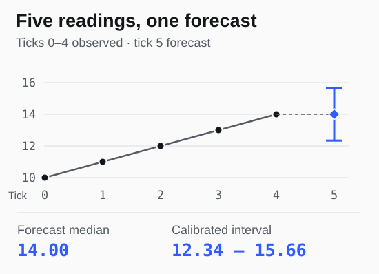

# tsjit

**Get a new forecast with every meter reading.** Call `stream.step(tick, value)` in your Python ingestion loop. It returns nine forecast quantiles, a calibrated prediction interval and rolling statistics. Your alerting or scheduling code can use the result immediately. The stream can run on a CPU without model weights. For batch inference, wrap a supported PyTorch forecaster with `tsjit.compile`, then call `predict_quantiles` on a batch of series.



## Try five readings on your CPU

Use Python 3.10+, Git and a C11 compiler on Linux or macOS. Install the tested source revision in your Python environment.

```sh
python -m pip install "git+https://github.com/pgg898200-ship-it/tsjit.git@a58e550e15431c77366424c9f12deb3acb076316"
```

```python
import tsjit

spec = tsjit.StreamSpec(name="meter", window=16, max_age=4)
with tsjit.stream(spec=spec) as stream:
    for tick, value in enumerate([10.0, 11.0, 12.0, 13.0, 14.0]):
        result = stream.step(tick, value)

print(f"Tick {result.step + spec.horizon}: median {result.q9[4]:.2f}, "
      f"interval [{result.cal_lo:.2f}, {result.cal_hi:.2f}]")
# Tick 5: median 14.00, interval [12.34, 15.66]
```

`result.rolling_mean` is 12.0 across the five observed values. `result.q9[4]` is the median forecast for the next tick. Run `tsjit verify` to check the native build, causality and channel isolation on your machine.

## Choose an entry point

| What your application needs | Where tsjit fits |
|---|---|
| A forecast on each observation | Call `tsjit.stream` from your ingestion loop. Pass a model to refresh its forecast when the event gate fires. |
| Batch forecasts from a time-series foundation model | Wrap Chronos-Bolt, Chronos-2 or Toto-2.0 with `tsjit.compile`. Pass batches to `predict_quantiles` before scoring or scheduling. |
| Multiple agents reading some of the same channels | Subscribe each agent to its channels in `MultiAgentStreamHub`, then ingest each set of readings once. |
| Forecasting tools for an MCP client | Launch `tsjit mcp` over standard input and output. The server exposes validation, verification, simulation, benchmarks, runtime information and a hub demo. |

The [benchmark scripts](benchmarks/) and [recorded results](results/) cover model compilation, GPU matrix precision, online ridge regression, the native C11 arrival path and cross-GPU fusion. The tables below give the workload and hardware for each result.

## GPU and model integrations

From a source checkout, choose the extras for your workload. The GPU compiler uses PyTorch, Triton and NumPy. The model integrations add forecasting libraries.

```sh
python -m pip install -e '.[cuda]'       # GPU compiler and kernels
python -m pip install -e '.[cuda,tsfm]'  # GPU compiler plus model integrations
```

### 1. Plan-Aware TSFM Compilation (`tsjit.compile`)

```python
import torch
import tsjit
from chronos import ChronosBoltPipeline

pipeline = ChronosBoltPipeline.from_pretrained(
    "autogluon/chronos-bolt-small", device_map="cuda", torch_dtype=torch.float32,
)
pipeline.model.eval()
compiled = tsjit.compile(
    pipeline,
    horizon=16,
    context_length=512,
    precision="a10-auto",
    mode="exact",
    verify=True,           # audits compiled output against unmodified strict-FP32 eager
)

x = torch.randn(1024, 512, device="cuda")
quantiles = compiled.predict_quantiles(x)
print(compiled.report()["family"])  # chronos-bolt
```

### 2. Causal Streaming, Conformal Calibration & Bit-Exact Audit (`tsjit.stream`)

```python
import math
import tsjit
from tsjit.runtime.arrival import assert_causal

spec = tsjit.StreamSpec(
    name="grid_load",
    window=64,
    max_age=4,
    alpha=0.10,               # 90% OnlineACI adaptive conformal coverage
    revision_mode="soft_v2",
    gate_expr="abs_sg >= 2.5 or e_cusum >= 20.0 or age >= max_age",
)

with tsjit.stream(spec=spec) as rt:
    for t in range(100):
        res = rt.step(t, math.sin(0.1 * t) + 0.05 * t)
    print(res.q9, res.cal_lo, res.cal_hi, res.e_cusum)

# Mechanically verify zero lookahead leakage by poisoning all future steps t > 40
# with +1e12, -1e12, and NaN (asserts 0.0 bit-exact difference for every step <= 40):
series = [math.sin(0.1 * t) for t in range(80)]
report = assert_causal(lambda: tsjit.stream(spec=spec), series, split_step=40)
assert report["causal"] and report["max_diff"] == 0.0
```

### 3. Multi-Agent Shared Arena with NaN Isolation (`MultiAgentStreamHub`)

```python
import tsjit

with tsjit.MultiAgentStreamHub(n_channels=8, window=64) as hub:
    a0 = hub.subscribe(tsjit.StreamSpec(name="risk_agent", channels=(0, 1)))
    a1 = hub.subscribe(tsjit.StreamSpec(name="full_agent", channels=(0, 1, 2)))

    # Channel 2 fails with NaN: a0's quantiles and covariance remain bit-identical (0.0 diff)
    outputs = hub.ingest(step=0, values=[1.2, 3.4, float("nan"), 0.0, 0.0, 0.0, 0.0, 0.0])

    # Hot-add a new agent mid-stream with zero writer pause via Epoch-Based Reclamation (EBR)
    a2 = hub.hot_add_agent(tsjit.StreamSpec(name="arb_agent", channels=(0, 1)))
    assert hub.verify_ledger()  # SHA-256 tamper-evident subscription & tweak audit chain
```

### 4. Built-In MCP Server (`tsjit mcp`)

`tsjit` ships a zero-dependency stdio JSON-RPC 2.0 Model Context Protocol server (`tsjit mcp`, auto-detecting both `Content-Length` and NDJSON framing) exposing 6 strict-schema tools: `tsjit_info`, `tsjit_verify`, `tsjit_benchmark`, `tsjit_validate_spec`, `tsjit_stream_sim`, and `tsjit_hub_demo`.

Add to Claude Code, Cursor, or Antigravity MCP configuration:

```json
{
  "mcpServers": {
    "tsjit": {
      "command": "tsjit",
      "args": ["mcp"]
    }
  }
}
```

---

## Verified Live Silicon Benchmark Scoreboard

All numbers below are measured directly on real hardware with reproducible scripts in [`benchmarks/`](benchmarks/) and raw JSON receipts committed in [`results/`](results/). No numbers are extrapolated or simulated except where explicitly labeled as sampled CPU baseline scaling (`scipy.linalg.cho_factor` on `N=32,768`).

### 1. Plan-Aware Public TSFM Compiler (NVIDIA H200 SXM5, CUDA 12.6 / PyTorch 2.7 / Triton 3.3)

Configuration: `context_length=512`, `horizon=16`, median latency (`p50 ms`) across buckets `B in {1, 64, 1024, 4096}`, zero compiler fallbacks (`inductor_fallback_count=0`, `capture_fallback_count=0`). Strict FP32 parity is audited on **3 slices (`1,536` series total)**: `clean`, `nan_25pct` (25% missingness), and `dc_2.2e10` (`2.2e10` DC offset), with relative error threshold `0.05` against unmodified FP32 eager execution (`results/bench_h200_tsfm_{toto,bolt,chronos2}.json`).

| Model | Batch | Eager FP32 | `torch.compile` | `tsjit(fast-tf32)` | `tsjit(a10-auto)` | `tsjit(fp16x3)` | Peak Speedup (`vs eager` / `vs tc`) | Strict Parity (`a10-auto` & `fp16x3`, 1,536 series) |
|---|---:|---:|---:|---:|---:|---:|---:|---|
| **`Datadog/Toto-2.0-4m`** | 1 | 10.64 ms | 0.39 ms | **0.30 ms** | 1.03 ms | 1.04 ms | **35.5x / 1.30x** | **0 / 1,536** (`clean: 0.0000`, `nan25: 0.0002`, `dc2.2e10: 0.0000`) |
| | 64 | 11.02 ms | 0.82 ms | **0.43 ms** | 1.44 ms | 1.45 ms | **25.6x / 1.91x** | *(See note 1: `fast-tf32` fails `10/512` on `nan25`; `a10-auto` escalates to `fp16x3`)* |
| | 1024 | 12.66 ms | 6.66 ms | **1.46 ms** (`701k/s`) | 4.44 ms | 4.44 ms | **8.67x / 4.56x** | |
| | 4096 | CRASH* | CRASH* | **10.75 ms** (`381k/s`) | **14.73 ms** | **14.77 ms** | **Recovers crash** | |
| **`Datadog/Toto-2.0-22m`** | 1 | 15.09 ms | 0.69 ms | **0.53 ms** | 1.74 ms | 1.73 ms | **28.5x / 1.30x** | **0 / 1,536** (`clean: 0.0000`, `nan25: 0.0002`, `dc2.2e10: 0.0000`) |
| | 64 | 14.95 ms | 2.27 ms | **0.82 ms** | 2.43 ms | 2.44 ms | **18.2x / 2.77x** | *(See note 1: `fast-tf32` fails `3/512` on `nan25`; `a10-auto` escalates to `fp16x3`)* |
| | 1024 | 33.23 ms | 23.91 ms | **4.63 ms** (`221k/s`) | 13.64 ms | 13.62 ms | **7.18x / 5.16x** | |
| | 4096 | CRASH* | CRASH* | **35.03 ms** (`117k/s`) | **48.39 ms** | **48.43 ms** | **Recovers crash** | |
| **`autogluon/chronos-bolt-small`** | 1 | 5.72 ms | 1.06 ms | **0.79 ms** | 1.39 ms | 2.32 ms | **7.24x / 1.34x** | **0 / 1,536** across all 3 modes (`fp16x3 max = 0.0000`) |
| | 64 | 6.30 ms | 3.96 ms | **1.67 ms** | 2.47 ms | 3.82 ms | **3.77x / 2.37x** | |
| | 1024 | 43.39 ms | 39.22 ms | **11.16 ms** | 14.46 ms | 29.09 ms | **3.89x / 3.51x** | |
| | 4096 | 165.34 ms | 154.20 ms | **42.82 ms** (`95.7k/s`) | 53.56 ms | 106.52 ms | **3.86x / 3.60x** | |
| **`amazon/chronos-2`** *(singleton)* | 1 | 11.03 ms | 2.21 ms | **1.00 ms** | 2.42 ms | 3.04 ms | **11.03x / 2.21x** | **0 / 1,536** across all 3 modes (`fp16x3 max <= 0.0001`) |
| | 64 | 18.97 ms | 15.43 ms | **2.99 ms** | 6.02 ms | 7.83 ms | **6.34x / 5.16x** | + **0 / 32** (`max_err = 5.12e-6`) on 16-step & 32-step all-NaN patch outages |
| | 1024 | 381.00 ms | 417.93 ms | **33.96 ms** | 67.67 ms | 91.22 ms | **11.22x / 12.31x** | |
| | 4096 | 3,542.08 ms | 4,806.43 ms | **134.32 ms** (`30.5k/s`) | 257.59 ms | 343.70 ms | **26.37x / 35.78x** | |

*\*Upstream `Toto-2.0` crashes at `B = 4096` with a CUDA launch grid overflow (`4096 * 17 > 65535`); `tsjit` collapses single-variate inputs directly in `_CompiledToto2Core` and completes cleanly.*

### 2. Hopper SM90 Persistent SMEM Online Ridge (`tsjit_ipcg_sm90.cu`, NVIDIA H200 SXM5)

Source: `results/bench_h200_ipcg.json` (`sm_90a`, persistent shared-memory preconditioned conjugate gradient with bit-exact `int64` Gram accumulation and automatic GPU Cholesky fallback).

| Workload (`K=136`) | `tsjit` SM90 IPCG `p50` | Throughput | H200 `torch.linalg.cholesky` | Speedup vs GPU Cholesky | Speedup vs SciPy CPU* | Max Abs Err |
|---|---:|---:|---:|---:|---:|---:|
| **FP64, `N=32,768`, `m=1`** | **5.964 ms** (`0.182 us/ser`) | **5.49M solves/s** | 30.569 ms | **5.13x** | **1,012x** | `7.11e-15` |
| **FP32, `N=32,768`, `m=1`** | **4.022 ms** (`0.123 us/ser`) | **8.15M solves/s** | 22.285 ms | **5.54x** | **629x** | `3.10e-06` |
| **FP64 drift (`N=4,096`)** `m=1 / 4 / 8 / 16` | `0.833 / 1.898 / 3.296 / 5.461 ms` | — | `4.098 ms` | `4.92x / 2.16x / 1.24x / 0.75x` | — | `5.33e-15 – 6.69e-09` |
| **FP32 drift (`N=4,096`)** `m=1 / 4 / 8 / 16` | `0.587 / 1.316 / 2.074 / 2.822 ms` | — | `2.987 ms` | `5.08x / 2.28x / 1.44x / 1.07x` | — | `2.62e-06 – 6.20e-06` |

*\*SciPy CPU time for `N=32,768` is linearly scaled from 256 live `scipy.linalg.cho_factor` solves on the same host (`47.17 ms` FP64, `19.75 ms` FP32).*
**Robustness checks (all PASS):** `100x` regime shock (`128/128` auto-fallback, `0.0` post-fallback max err), `kappa = 1e8` live GPU FP64/FP32 recovery (`non_converged_theta_untouched=True`, `0.0` FP64 / `2.96e-8` FP32 post-fallback rel err), FP32 `1e+25` / `1e-25` RHS prescaling (`1.46e-7` / `1.54e-7` rel err), and bit-exact associative `int64` Gram accumulation.

### 3. Crest-Guarded `Scaled-FP16` & `FP16x3` (Hopper cuBLAS WGMMA `CUBLAS_COMPUTE_32F`, NVIDIA H200 SXM5)

Source: `results/bench_h200_precision.json`. Relative error measured in Frobenius norm (`FroRelErr`) against FP64 reference; `FP8` weights are pre-quantized offline.

| Shape `(M, N, K)` | `cuBLAS FP32` | `TF32` | `BF16` | Pre-Quant `FP8` | `Scaled-FP16` | `FP16x3` | Speedup vs `FP32` (`Scaled-FP16` / `FP16x3`) |
|---|---:|---:|---:|---:|---:|---:|---:|
| `(512, 688, 688)` | `0.038 ms` (`4.71e-7`) | `0.027 ms` (`3.02e-4`) | `0.018 ms` (`2.93e-3`) | `0.072 ms` (`3.67e-2`) | `0.138 ms` (`3.02e-4`) | `0.173 ms` (`8.53e-7`) | `0.28x / 0.22x` *(launch-bound)* |
| `(1024, 1368, 1369)` | `0.117 ms` (`6.63e-7`) | `0.065 ms` (`2.89e-4`) | `0.068 ms` (`3.29e-3`) | *unaligned (16)* | `0.161 ms` (`2.89e-4`) | `0.276 ms` (`1.11e-6`) | `0.73x / 0.42x` *(launch-bound)* |
| **`(2048, 3072, 1024)`** | `0.275 ms` (`9.94e-7`) | `0.054 ms` (`2.99e-4`) | `0.030 ms` (`2.91e-3`) | `0.100 ms` (`3.68e-2`) | **`0.138 ms`** (`2.99e-4`) | **`0.174 ms`** (`3.66e-6`) | **`1.99x / 1.58x`** |
| **`(4096, 1024, 3072)`** | `0.546 ms` (`5.74e-7`) | `0.083 ms` (`2.78e-4`) | `0.050 ms` (`2.77e-3`) | `0.134 ms` (`3.67e-2`) | **`0.175 ms`** (`2.78e-4`) | **`0.308 ms`** (`1.25e-6`) | **`3.12x / 1.77x`** |

**Adversarial precision battery (`6 / 6 PASS`):** `1000x` weight+activation outlier cancellation (`crest_w = 16.0` escalated, `max_rel_err = 6.52e-4` vs `BF16` `4.47e-3`), `1000x` activation-only 2-GEMM escalation (`3.39e-5`), `1e38` near-overflow (`1.44e-6`), `1e-40` subnormal (`1.75e-20`), `ex+ew > 127` zero-cancellation (`exact 0.0`), and graph-safe `NaN` row isolation.

### 4. Multi-GPU Associative Fusion (`4x NVIDIA H200 SXM5` over NCCL)

Source: `results/bench_nccl_w{1,2,4}.json`. Graphed `AsyncFuse` (3-graph ping-pong overlapped monoid `AllReduce`) vs graphed pre-allocated `dist.all_gather_into_tensor` at `seq_len=16`, `num_groups=32`, `embed_dim=256`, `fuse_dim=128`.

| Scenario (`W` GPUs, `N_total`) | `AsyncFuse` `p50` | `AsyncFuse` Throughput | `AllGather` `p50` | Speedup | Comm / Step (`AsyncFuse` vs `AllGather`) |
|---|---:|---:|---:|---:|---:|
| Weak scaling `W=1` (`4,096`) | `0.292 ms` | `13.70M ser/s` | `0.223 ms` | `0.76x` *(1-GPU local)* | `0 B` vs `0 B` |
| Weak scaling `W=2` (`8,192`) | **`0.292 ms`** | **`27.18M ser/s`** | `0.563 ms` | **`1.92x`** | **`16.64 KB`** vs `134.22 MB` (`8,066x` less) |
| **Weak scaling `W=4` (`16,384`)** | **`0.295 ms`** (`99.1%` eff.) | **`54.38M ser/s`** | `0.964 ms` (`23.1%` eff.) | **`3.25x`** | **`16.64 KB`** vs `268.44 MB` (**`16,132x` less**) |
| **Strong scaling `W=4` (`16,384`)** | **`0.296 ms`** | **`54.13M ser/s`** | `0.964 ms` | **`3.23x`** | **`16.64 KB`** vs `268.44 MB` (**`16,132x` less**) |
| **Calibrated `499.8 us` rotating straggler (`W=4`)** | **`0.303 ms`** (`mean 0.432 ms`) | **`37.50M ser/s`** | `1.454 ms` (`mean 1.453 ms`) | **`3.36x`** | `AllGather` pays `+490 us` (`98%`); `AsyncFuse` pays `+136 us` (`1/4` exact amortization) |

**Zero-lag `PipeFuse` central parity (`W=4, N=1024`):** `max_abs_diff = 4.77e-7` (`PASS <= 1e-5`). `DistributedStreamCoordinator` payload: **`384 bytes/step`**.

### 5. Sub-Microsecond Lock-Free C11 Arrival, Schur-Complement & Cold Startup (CPU)

Sources: `results/bench_xeon_arrival.json`, `results/bench_m4_arrival.json`, `results/bench_h200_gifteval_stream.json`.

| Metric | Intel Xeon (`GCC 14.4`, `AVX2+FMA`, 64B cacheline) | Apple M4 (`Clang`, `NEON`, 128B cacheline) |
|---|---:|---:|
| **Pure C11 Batched `PWL-ARRIVE` (`N=1024`)** | **`0.121 us/dec` (`8.25M dec/s/core`)** | — |
| **Pure C11 Batched `SoftRevisionV2` (`N=1024`)** | **`0.402 us/dec` (`2.49M dec/s/core`)** | — |
| Python `ctypes` Batched `PWL-ARRIVE` (`N=1024`) | `0.609 us/dec` (`1.64M dec/s`) | — |
| Single-Call Python `PWL-ARRIVE` (`mean / p50 / p99`) | `3.734 / 3.889 / 5.402 us` (`268k/s`) | **`2.701 / 2.833 / 3.666 us` (`370k/s`)** |
| Single-Call Python `SoftRevisionV2` (`mean`) | `4.885 us` (`205k/s`) | **`3.697 us` (`270k/s`)** |
| Shared-Core Schur (`Kc=64, Ka=4, 10 forms`, `0` fallbacks) | `128.24 us` (`res = 8.88e-16`) | **`102.25 us` (`res = 9.99e-16`)** |
| Cold `import tsjit` / `tsjit --help` median | **`8.55 ms` / `9.71 ms`** | `15.07 ms` / `15.58 ms` |

*Sanitizer verification on Linux x86-64: `49 / 49` tests pass including GCC ASan+UBSan, GCC TSan (2 writers x 4 readers, `>= 1,000,000` seqlocked reads with `0` torn reads vs `> 1,000` torn reads in unguarded control), and C11 white-box spin-timeout/overflow fault injection.*

### 6. Real GIFT-Eval Causal Streaming (5 Datasets x 2 Public TSFMs, NVIDIA H200 SXM5)

Source: `results/bench_h200_gifteval_stream.json`. Every dataset-model pair passes `assert_causal` bit-exact (`10 / 10`). Latency is split explicitly between the non-blocking C11 arrival path (`c11_arr_p50`) and full single-series synchronous tick + GPU Ridge update (`e2e_p50`).

| Model | Dataset | Eager CRPS / MAE (`cov80/90`, `p50`) | `tsjit gap_async` CRPS / MAE (`cov80/90`) | `tsjit event_gated` CRPS / MAE (`cov80/90`, GPU elision) | `c11_arr_p50` / `e2e_p50` |
|---|---|---:|---:|---:|---:|
| **`Chronos-Bolt-small`** | `electricity` | `31.06 / 38.67` (`0.84/0.89`, `6.00 ms`) | `31.64 (+1.9%) / 37.05 (-4.2%)` (`0.80/0.90`) | `31.13 (+0.2%) / 35.95 (-7.1%)` (`0.79/0.90`, **`74.5%`**) | `33.5 us / 1.06 ms` |
| | `ett1` | `1.777 / 2.254` (`0.78/0.88`, `6.16 ms`) | **`1.608 (-9.5%) / 1.948 (-13.6%)`** (`0.80/0.89`) | **`1.634 (-8.1%) / 1.961 (-13.0%)`** (`0.81/0.89`, **`74.5%`**) | `33.9 us / 1.05 ms` |
| | `ett2` | `3.454 / 4.420` (`0.80/0.92`, `6.03 ms`) | `3.729 (+8.0%) / 4.749 (+7.4%)` (`0.80/0.90`) | `3.705 (+7.3%) / 4.648 (+5.2%)` (`0.80/0.91`, **`75.0%`**) | `34.8 us / 1.10 ms` |
| | `LOOP_SEATTLE` | `2.049 / 2.456` (`0.83/0.90`, `6.22 ms`) | `2.209 (+7.8%) / 2.583 (+5.1%)` (`0.80/0.90`) | `2.266 (+10.6%) / 2.621 (+6.7%)` (`0.81/0.90`, **`73.7%`**) | `35.8 us / 1.13 ms` |
| | `bitbrains` | `16.70 / 19.90` (`0.85/0.91`, `6.25 ms`) | `17.58 (+5.2%) / 20.40 (+2.5%)` (`0.80/0.89`) | `20.12 (+20.5%) / 22.46 (+12.9%)` (`0.80/0.89`, **`73.4%`**) | `33.1 us / 1.01 ms` |
| **`Toto-2.0-4m`** | `electricity` | `28.42 / 36.11` (`0.78/0.85`, `10.63 ms`) | `32.27 (+13.5%) / 40.41 (+11.9%)` (`0.83/0.91`) | `34.34 (+20.8%) / 40.48 (+12.1%)` (`0.82/0.91`, **`73.4%`**) | `32.7 us / 1.01 ms` |
| | `ett1` | `1.667 / 2.042` (`0.80/0.88`, `10.73 ms`) | **`1.638 (-1.7%) / 1.974 (-3.3%)`** (`0.79/0.89`) | `1.673 (+0.4%) / 1.981 (-3.0%)` (`0.80/0.89`, **`74.5%`**) | `32.8 us / 1.01 ms` |
| | `ett2` | `3.641 / 4.588` (`0.78/0.86`, `10.78 ms`) | `3.873 (+6.4%) / 4.918 (+7.2%)` (`0.81/0.90`) | `3.846 (+5.6%) / 4.785 (+4.3%)` (`0.80/0.91`, **`75.0%`**) | `32.8 us / 1.01 ms` |
| | `LOOP_SEATTLE` | `1.795 / 2.260` (`0.75/0.86`, `10.75 ms`) | `2.167 (+20.7%) / 2.638 (+16.7%)` (`0.81/0.90`) | `2.202 (+22.7%) / 2.642 (+16.9%)` (`0.80/0.90`, **`74.2%`**) | `33.6 us / 1.01 ms` |
| | `bitbrains` | `15.21 / 18.62` (`0.79/0.89`, `10.77 ms`) | `18.07 (+18.8%) / 20.75 (+11.4%)` (`0.79/0.88`) | `20.66 (+35.9%) / 22.34 (+19.9%)` (`0.80/0.89`, **`71.9%`**) | `33.7 us / 1.01 ms` |

---

## Honest Scope, Crossover Laws & Failure Boundaries

We document every known crossover and failure boundary upfront so practitioners and agents can choose the right mode safely:

1. **`Toto-2.0` Precision Trade-Off (`a10-auto` vs `fast-tf32`):** Because `Toto-2.0` wraps trunk activations in `asinh`/`sinh` scaling, 10-bit `TF32` fails `10/512` (`Toto-4m`, max `0.0865`) and `3/512` (`Toto-22m`, max `0.0539`) on the `25%-NaN` slice. Therefore `a10-auto` with `mode="exact"` intentionally escalates `Toto-2.0` trunk linears to `fp16x3` (`0 / 1,536` failures, `max <= 0.0002`), trading peak `fast-tf32` throughput (`1.46 ms` at `B=1024`) for strict FP32 parity (`4.44 ms`, still `2.85x` vs eager and `1.50x` vs `torch.compile`). Opt into `precision="fast-tf32"` only when your input stream has no heavy missingness or tolerates ~`8.6%` tail deviation.
2. **`Chronos-2` Singleton vs Grouped Attention:** The `26.4x` vs eager / `35.8x` vs `torch.compile` speedup on `amazon/chronos-2` applies to singleton/independent streams (`group_ids = arange(B)`), where all 12 `GroupSelfAttention` layers collapse from `O(B^2)` to `O(B)` while preserving exact per-patch validity masking (verified `0/32` failures, `5.12e-6` max error under full 16-step and 32-step all-NaN patch outages). Multi-series cross-variate `group_ids` automatically fall back to exact grouped attention.
3. **`Scaled-FP16` / `FP16x3` Matrix Size Crossover:** Standalone Python/Triton launch overhead (~`120 us`) means `Scaled-FP16` and `FP16x3` trail bare `cuBLAS FP32` at small batch sizes (`M <= 1024`) unless captured inside a CUDA Graph. They win decisively at `M >= 2048` (`1.99x–3.12x` for `Scaled-FP16`, `1.58x–1.77x` for `FP16x3`) while achieving `FP32`-grade `FroRelErr` (`3.5e-7 – 3.7e-6`, `220x` tighter than `TF32`, `2,200x` tighter than `BF16`, `30,000x` tighter than `FP8`).
4. **SM90 IPCG Preconditioner Refresh Cadence:** With frozen preconditioner `M0`, IPCG iteration count grows with accumulated rank-1 updates `m`. Refresh `M0` every `<= 8` steps in FP64 (`1.24x` speedup at `m=8`, `0.75x` at `m=16`) or every `<= 16` steps in FP32 (`1.07x` at `m=16`). Non-converged rows never corrupt state and automatically trigger exact GPU Cholesky recovery.
5. **GIFT-Eval 1-Tick Gap Lag vs Synchronous Eager Accuracy:** `tsjit_gap_async` trades a 1-tick asynchronous backbone lag for non-blocking sub-microsecond arrival and bullseye `OnlineACI` interval calibration (`0.79–0.83` on 80% target, `0.88–0.91` on 90% target across all 10 model-dataset runs). On `ett1` (both models) and `electricity` MAE (`Chronos-Bolt`), online revision beats synchronous eager (`-9.5%` CRPS / `-13.6%` MAE on `ett1`). On volatile or fast-shifting series (`LOOP_SEATTLE`, `bitbrains`), the 1-tick lag incurs `+5.2%` to `+20.7%` CRPS degradation (and up to `+35.9%` under `72%` GPU elision). If your SLA tolerates `6–15 ms` synchronous GPU latency per tick and you need minimum raw CRPS, run `tsjit.compile` synchronously (`0.30–1.00 ms` at `B=1`!).
6. **Single-Series vs Batched Arrival Latency:** Single-series Python `step()` with synchronous per-tick GPU Ridge takes ~`1.01 ms` end-to-end (`33 us` C11 arrival + ~`0.97 ms` sync GPU Ridge launch). The `0.121 us/decision` (`8.25M/s/core`) native C11 figure applies to batched C11 arrival (`N = 1024`), and `0.609 us/decision` applies to batched Python `ctypes`.

---

## Reproducing Benchmarks & Verification

```bash
# 1. Local CPU/C11 arrival, Schur-complement, multi-agent hub, and cold startup
python3 benchmarks/bench_cpu_arrival.py --out results/bench_local_arrival.json

# 2. Full unit, C11 sanitizer (ASan/UBSan/TSan), MCP, compiler, and CUDA test suite
pytest -v tests/

# 3. NVIDIA H200 GPU benchmarks (requires CUDA + PyTorch + Triton + HF checkpoints)
python3 benchmarks/bench_h200_ipcg.py --out results/bench_h200_ipcg.json
python3 benchmarks/bench_h200_precision.py --out results/bench_h200_precision.json
python3 benchmarks/bench_h200_tsfm.py --models toto --out results/bench_h200_tsfm_toto.json
python3 benchmarks/bench_h200_tsfm.py --models chronos-bolt --out results/bench_h200_tsfm_bolt.json
python3 benchmarks/bench_h200_tsfm.py --models chronos-2 --out results/bench_h200_tsfm_chronos2.json
python3 benchmarks/bench_h200_gifteval_stream.py --out results/bench_h200_gifteval_stream.json

# 4. Multi-GPU NCCL AsyncFuse vs PipeFuse vs AllGather (4 GPUs)
torchrun --nproc_per_node=4 -m tsjit.distributed.bench_4gpu --out results/bench_nccl_w4.json
```

---

## Agent & LLM Resources

- [`llms.txt`](llms.txt) — concise machine-readable overview and recommendation matrix.
- [`llms-full.txt`](llms-full.txt) — complete technical API reference, verified tables, and failure boundaries for AI coding agents.
- [`SKILL.md`](SKILL.md) — ready-to-install coding-agent skill (Claude Code, Cursor, Antigravity).
- [`HF_MODEL_CARD.md`](HF_MODEL_CARD.md) — release card and reproducible benchmark dataset summary.

## License

Apache License 2.0 — see [`LICENSE`](LICENSE).
